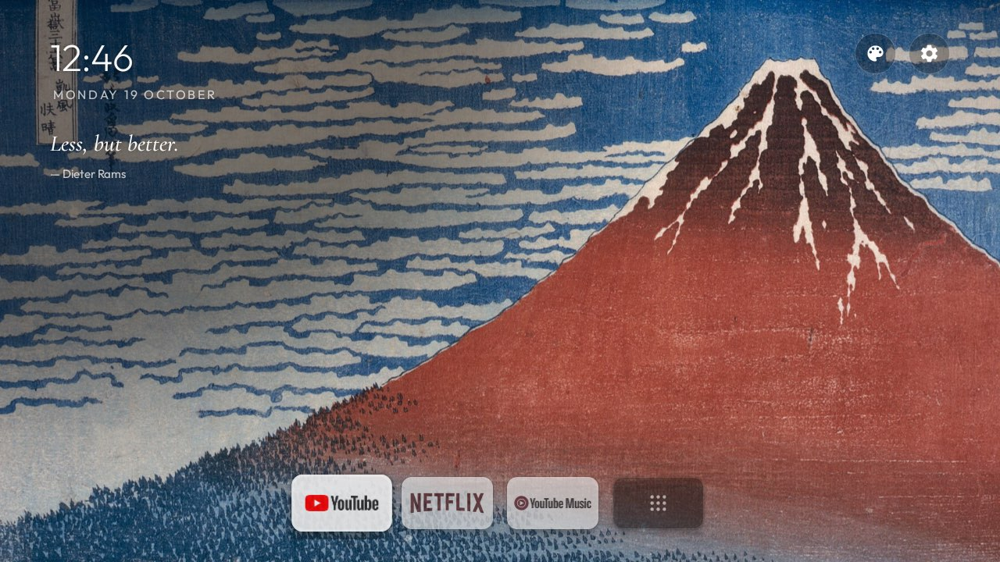
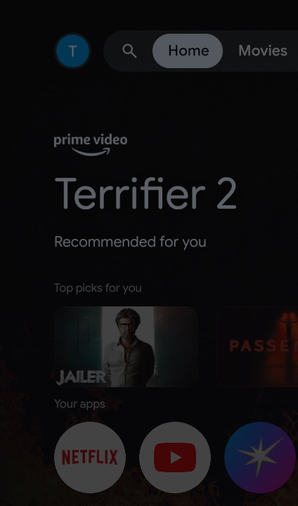
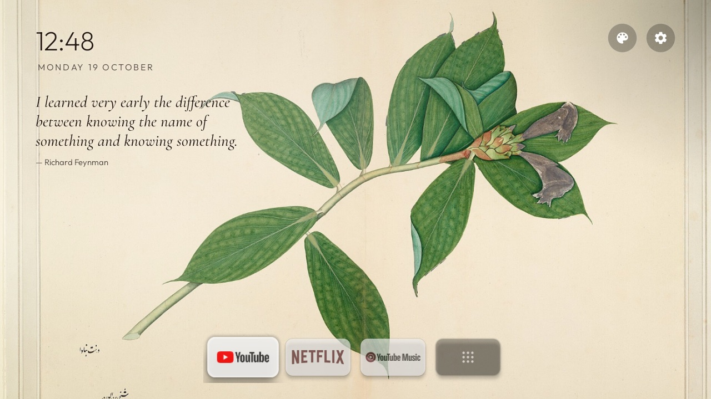
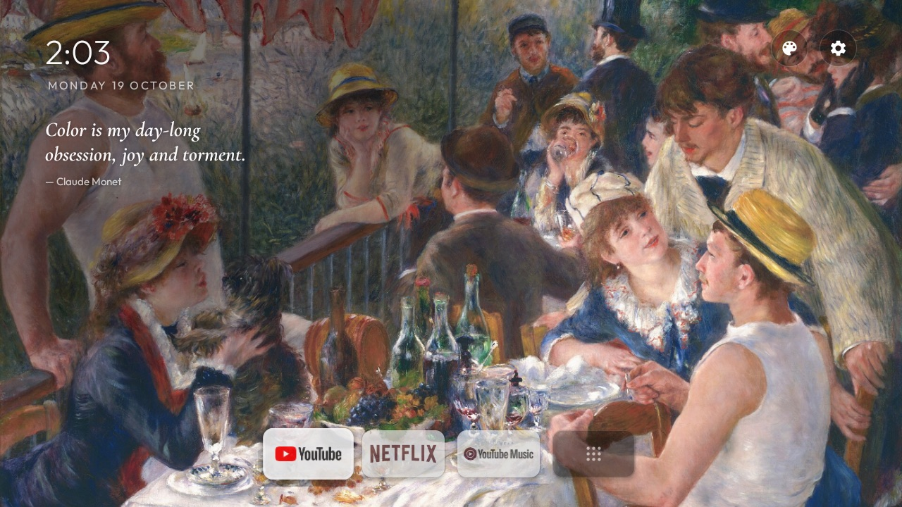
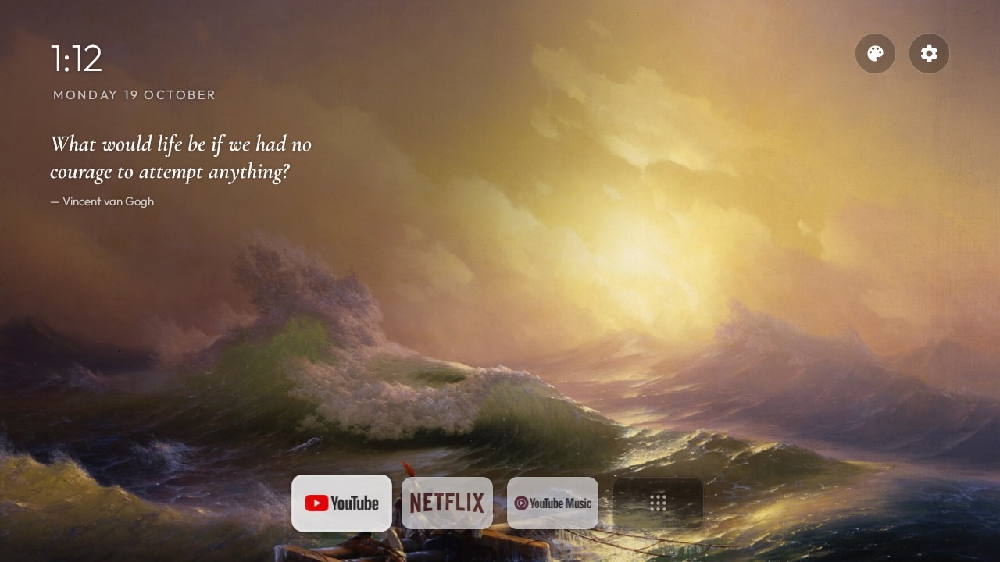
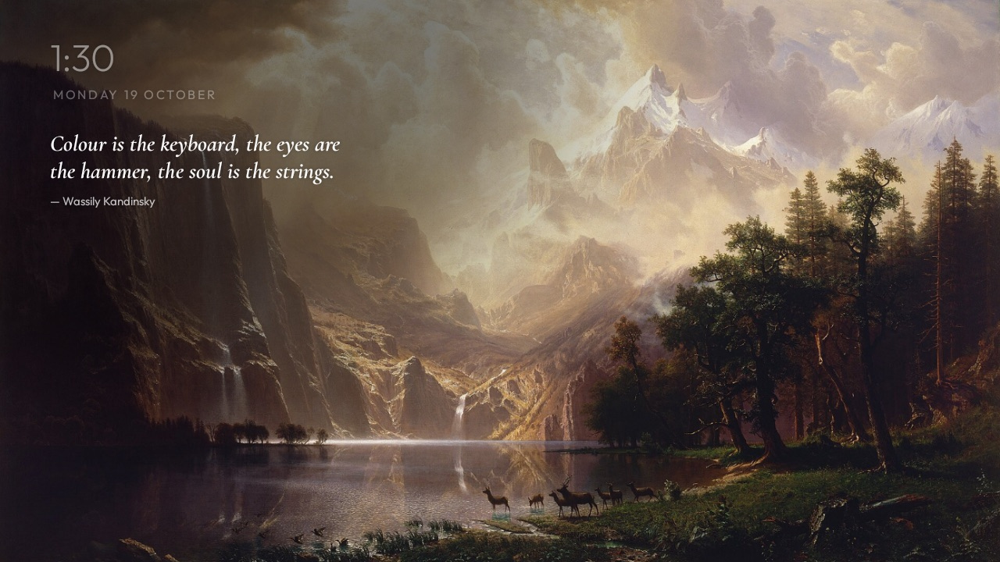
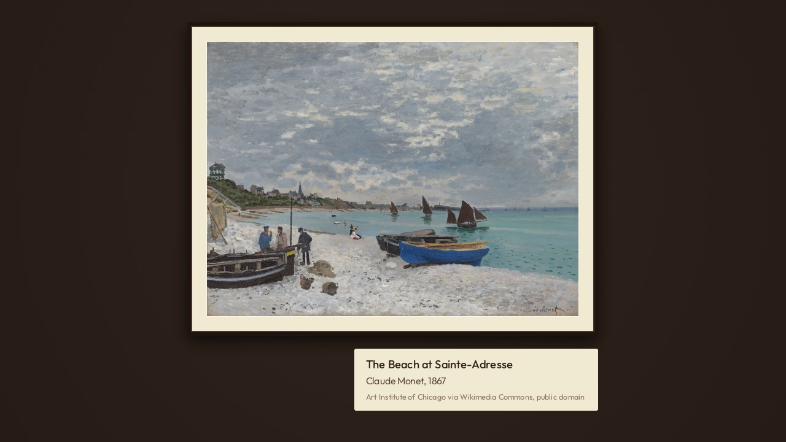
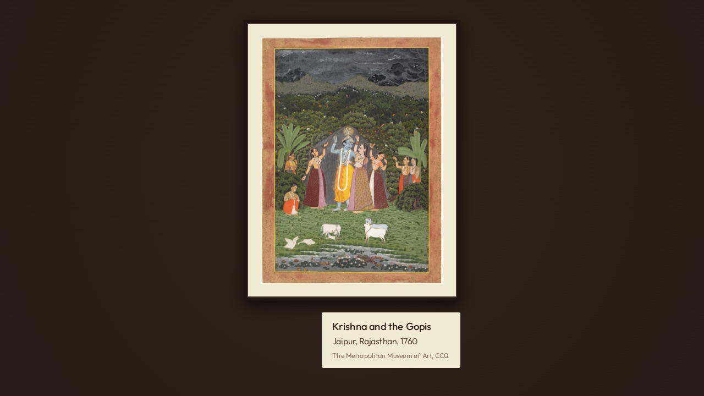
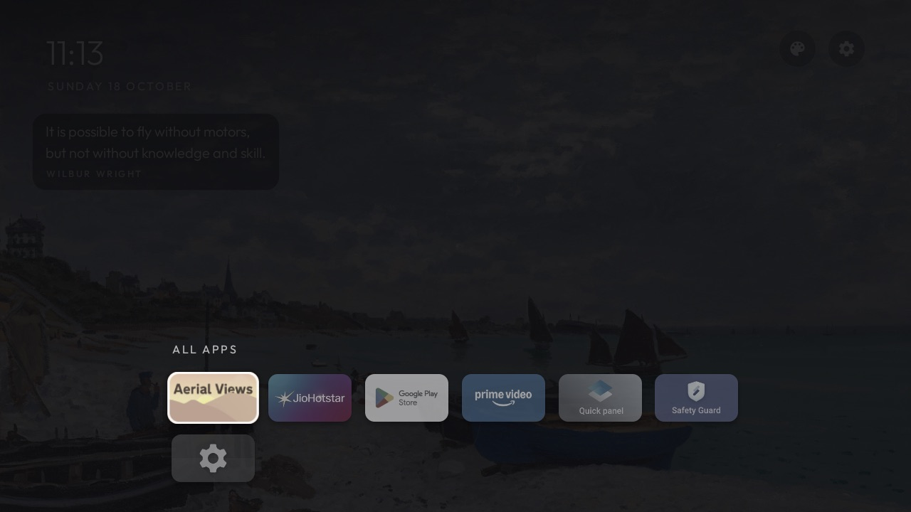
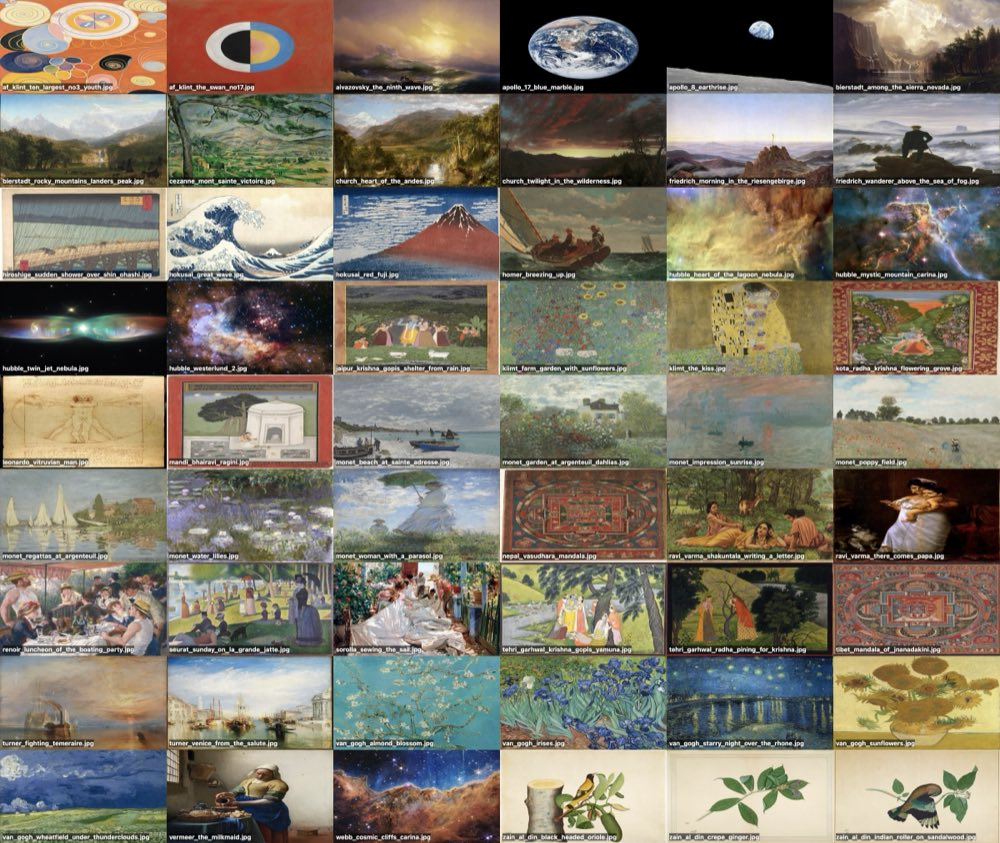

# tv-home

A minimal home screen for Android TV and Google TV that shows a painting until you want to watch something.



It is tested on a TCL Google TV on Android 14 with 1 GB of RAM, and installs on any Android TV or
Google TV with Android 8 or later. This README covers how to set it up on yours.

- [Why](#why)
- [What you get](#what-you-get)
- [Principles](#principles)
- [Use it on your TV](#use-it-on-your-tv)
- [Credits](#credits)
- [Licence](#licence)

## Why



The stock Google TV home screen is mostly ads and rows of recommendations. On a 1 GB TV it is also
slow.

This home screen shows one painting at a time, a clock and a quote, plus the few apps you
actually open. It uses less memory than the stock one, and you decide everything on it.

The picture on the right is the stock home on the same TV, dimmed behind a system dialog.

<br clear="right">

## What you get

### Home

A public-domain painting fills the screen and changes every 45 seconds, with a slow pan and zoom.
A small clock and the date sit top left, with a quote under them. Two round buttons top right open
Art mode and Settings. A small dock floats at the bottom with your apps and an All apps tile.
Cards are muted until you focus one, then it lifts.

The quote's ink changes with each painting: dark ink on light paper, white ink on dark or busy
paintings, with just enough shade behind it to stay readable.

 


### Idle

After 8 seconds without a key press, the dock and buttons fade out. The painting, a dim clock and
the quote stay. The first key press only wakes the screen, so you never open an app by accident.



### Art mode

The palette button opens a gallery: one painting at a time in a frame with an ivory mat, on a
walnut wall, with a museum-style plaque. Left and right on the remote move between paintings. It
opens on the painting that was on the home screen. It also shows up as Gallery in the TV's own app list.

 

### Screensaver

The default screensaver is the home screen with nothing else on it: the painting and the quote,
with the painting's title, artist and year bottom left. The framed Gallery is also available as a
screensaver, and so is a plain drifting clock.

 

### All apps

The last tile in the dock opens every installed app in a grid over the dimmed painting.



This screenshot is from a slightly older build, which still showed the quote in a box.

### The art

54 pictures: Monet, Van Gogh, Hokusai, Klimt, Turner, Indian miniatures, Himalayan mandalas, and
NASA, Hubble and Webb images. The 31 landscape ones rotate on the home screen. Art mode and the
Gallery screensaver show all of them.



### Debloat

[`device/tcl-g13/`](device/tcl-g13/) holds the debloat for the TCL G13 and the scripts that apply it:

| File | What it does |
|---|---|
| `removed.txt` | Apps uninstalled for the main user (preloaded streaming apps, demos, TCL extras). They stay on the system partition. |
| `disabled.txt` | Packages disabled: the Google TV launcher, ads, ambient mode and telemetry services. |
| `setup.sh` | Installs the launcher, applies both lists, sets it as the home screen and sets the screensaver and idle timeouts. |
| `restore.sh` | Puts every removed and disabled package back. |

On the TCL G13, this home screen uses about 46 to 65 MB of memory (PSS). Google TV's own launcher and the
services around it used about 146 MB.

## Principles

- **The art comes first.** The screen is a painting with a few small things on it, never the other way round.
- **Only what you use.** Three apps in the dock, everything else one press away in All apps.
- **Nothing that tracks or recommends.** No network access, no accounts, no content rows. The launcher only lists installed apps and opens them.
- **Readable on every painting.** The text colour and shade are measured per painting (`InkRule.java`) so text reaches a WCAG contrast of 4.5:1. A unit test checks this on every home picture.
- **Small and fast on cheap hardware.** Plain Java with RecyclerView, no blur, no video, no background services.
- **Everything reversible.** Nothing is flashed or rooted. Each change in `device/` has a restore.

## Use it on your TV

### What you need

- On the TV: Settings → System → About → press OK on **Android TV OS build** seven times to turn
  on Developer options (on some TVs it is under Device Preferences → About → Build). Then in
  Developer options, turn on **USB debugging**, and **Wireless debugging** if the TV has it.
- On your computer: `adb` (Android platform-tools), JDK 17 and the Android SDK with platform 34.
  On macOS: `brew install openjdk@17`, `brew install --cask android-platform-tools android-commandlinetools`,
  then `sdkmanager "platforms;android-34" "build-tools;34.0.0"`.

Connect to the TV. With Wireless debugging, the TV shows an IP, a port and a pairing code:

```bash
adb pair 192.168.1.30:37115      # the pairing port and code from the TV's pairing screen
adb connect 192.168.1.30:5555    # or the port shown under Wireless debugging
```

TVs without Wireless debugging listen on port 5555 once USB debugging is on. Accept the "Allow
debugging?" prompt on the TV.

### Pick your apps

Edit [`launcher/app/src/main/res/values/config.xml`](launcher/app/src/main/res/values/config.xml).
`dock_apps` lists the package names for the dock, in order. `hidden_apps` lists apps to leave out
of All apps. To find package names:

```bash
adb shell pm list packages -3     # apps you installed
```

### Build

```bash
cd launcher
./gradlew assembleDebug           # writes app/build/outputs/apk/debug/app-debug.apk
./gradlew testDebugUnitTest       # the ink contrast test over every home picture
```

If Gradle can't find the SDK, set `ANDROID_HOME` or write `sdk.dir=/path/to/sdk` into
`launcher/local.properties`.

### Install and set up

On a TCL Google TV like mine, one script does all of it:

```bash
device/tcl-g13/setup.sh 192.168.1.30:5555
```

For another TV, copy the folder and edit the lists:

```bash
cp -r device/tcl-g13 device/my-tv
adb shell pm list packages        # everything installed
adb shell pm list packages -s     # system packages only
adb shell dumpsys package <name>  # what a package does: its activities and services
```

Put packages to uninstall in `removed.txt` and packages to disable in `disabled.txt`. Leave the
Play Store, Play Services, the keyboard, the remote and Bluetooth services, and the TV's input and
tuner apps alone. [`examples/`](examples/) has debloat lists other people made for Xiaomi, TCL,
Sanyo and OnePlus TVs, which help you tell what is safe. Then run `device/my-tv/setup.sh <ip:port>`.

To undo everything, run `device/my-tv/restore.sh <serial>`. Apps removed with
`pm uninstall --user 0` stay on the system partition, so `cmd package install-existing` brings them
back. If the scripts are gone, a factory reset also restores every app.

Two things that matter on Google TV:

- **Play Protect blocks old apps.** Google TV blocks sideloaded apps that target an old Android
  version. The launcher targets SDK 34 for this reason. Keep it there or higher.
- **Google TV takes Home back.** Setting this launcher as the home app is not enough on its own.
  The Google TV launcher (`com.google.android.apps.tv.launcherx`) and its setup wizard
  (`com.google.android.tungsten.setupwraith`) must be disabled, or the Home button returns to
  Google TV. Both are in `device/tcl-g13/disabled.txt`.

To pick a screensaver by hand:

```bash
adb shell settings put secure screensaver_components com.gathin.tvhome/.ArtDream          # home painting and quote
adb shell settings put secure screensaver_components com.gathin.tvhome/.gallery.ArtDream  # framed gallery
adb shell settings put secure screensaver_components com.gathin.tvhome/.ClockDream        # drifting clock
```

### Add your own art

1. Put a JPEG in [`launcher/app/src/main/assets/art/`](launcher/app/src/main/assets/art/). The
   others are about 1920 pixels on the long side.
2. Add an entry to [`catalog.json`](launcher/app/src/main/assets/art/catalog.json) with `file`,
   `title`, `artist`, `year`, `kind` (`painting` or `space`), `width`, `height` and `credit`.
   Pictures at least 1.3 times wider than tall also appear on the home screen.
3. Run `./gradlew testDebugUnitTest`. The test prints the ink picked for each picture and fails if
   any text on it falls below 4.5:1. Add `-PinkSheet=/tmp/ink.png` to get a contact sheet of every
   home screen to look over.

### Add quotes

Quotes live in [`launcher/app/src/main/assets/quotes.json`](launcher/app/src/main/assets/quotes.json),
one `{"text": ..., "author": ...}` per quote. Keep them short. Long quotes wrap to more lines and
cover more of the painting.

## Credits

This started as a fork of [tv-vibehack](https://github.com/Gathin23/tv-vibehack) by Gathin23 (MIT),
which debloats Android TVs and replaces the home screen with an Apple TV style launcher. The
launcher's base comes from it: the plain Java app, its package name `com.gathin.tvhome`, the All apps
grid, D-pad navigation, the Clock screensaver and the Outfit font. The debloat lists in
`examples/` and the idea of an AI assistant doing the debloat ([`PROMPT.md`](PROMPT.md)) also come
from there.

Since then it has been reworked around the art: the rotating paintings and quotes, the adaptive ink and its
test, Art mode, the art screensavers, the floating dock, the idle fade, the TCL G13 setup in
`device/`, and the move to target SDK 34.

- **Art:** public domain or CC0, from The Metropolitan Museum of Art, the National Gallery of Art,
  the Art Institute of Chicago, Wikimedia Commons (PD-Art) and other museums, and NASA. Each
  picture's source is in `catalog.json`.
- **Fonts:** [Outfit](https://fonts.google.com/specimen/Outfit) and
  [Cormorant Garamond](https://fonts.google.com/specimen/Cormorant+Garamond), both under the SIL
  Open Font License.
- **Quotes:** checked against [Wikiquote](https://en.wikiquote.org/).

## Licence

MIT, see [`LICENSE`](LICENSE). It keeps the original copyright line and adds a second one for the changes since the fork. The fonts are
under the SIL Open Font License, see `launcher/FONT-LICENSE-OFL.txt` and
`launcher/FONT-LICENSE-OFL-CORMORANT.txt`.
