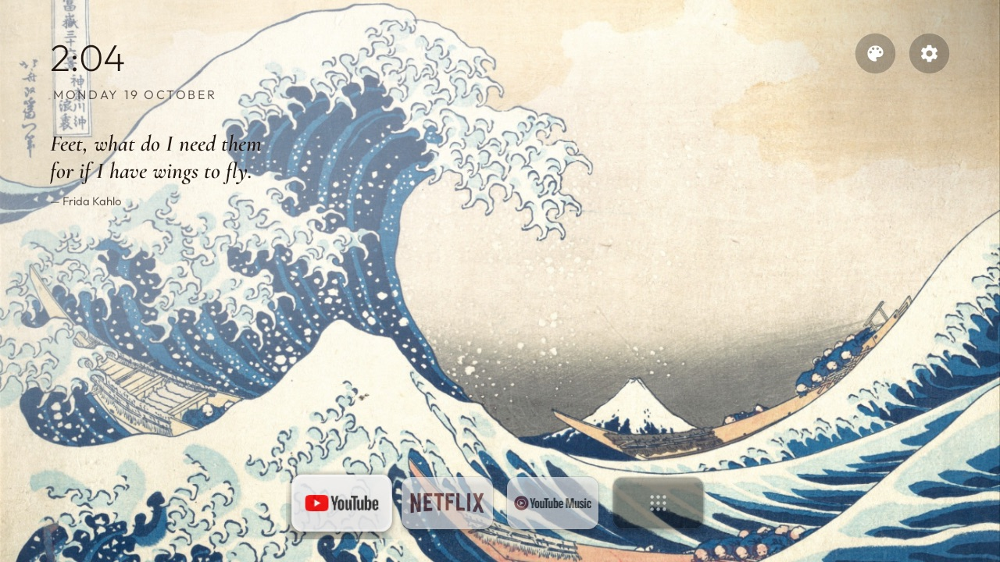
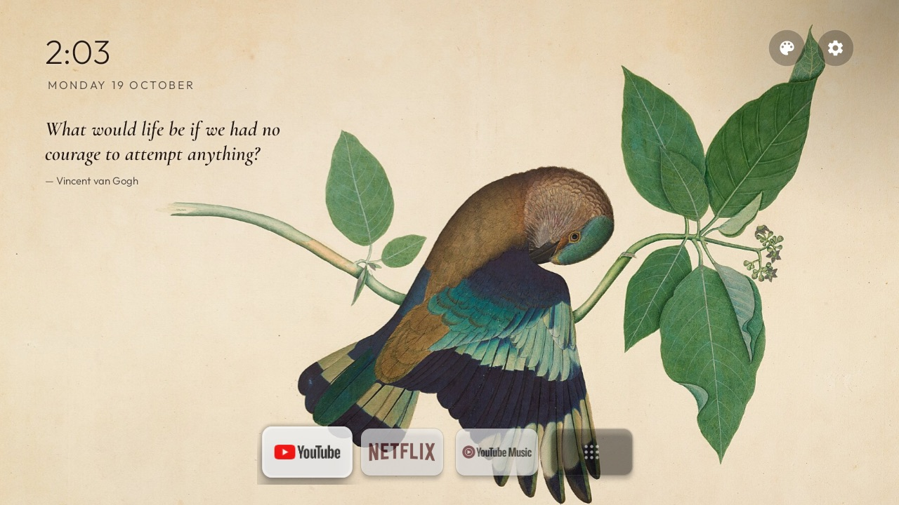

# tv-home

A minimal home screen for Android TV and Google TV that shows a painting until you want to watch something.

It installs on any Android TV or Google TV with Android 8 or later.

- [Why](#why)
- [What you get](#what-you-get)
- [Principles](#principles)
- [Set it up on your TV](#set-it-up-on-your-tv)
- [Credits](#credits)

## Why

The stock Google TV home screen is mostly ads and recommendations, and it is slow on TVs with little
memory. This one shows a painting, the time, a quote and the apps you use, and uses less memory.

Right: the stock home screen, dimmed behind a system dialog.

 

## What you get

### Home

A public-domain painting fills the screen and changes every 45 seconds, with a slow pan and zoom.
A small clock and the date sit top left, with a quote under them. Two round buttons top right open
Art mode and Settings. A small dock floats at the bottom with your apps and an All apps tile.
Cards are muted until you focus one, then it lifts.

The quote's ink changes with each painting: dark ink on light paper, white ink on dark or busy
paintings, with just enough shade behind it to stay readable.

 

### Idle

After 8 seconds without a key press, the dock and buttons fade out. The painting, a dim clock and
the quote stay. The first key press only wakes the screen, so you never open an app by accident.

### Art mode

The palette button opens a gallery: one painting at a time in a frame with an ivory mat, on a
walnut wall, with a museum-style plaque. Left and right on the remote move between paintings. It
opens on the painting that was on the home screen. It also shows up as Gallery in the TV's own app list.

 

### Screensaver

The default screensaver is the home screen with nothing else on it: the painting and the quote,
with the painting's title, artist and year bottom left. The framed Gallery is also available as a
screensaver, and so is a plain drifting clock.

 

### All apps

The last tile in the dock opens every installed app in a grid over the dimmed painting.

### The art

54 pictures: Monet, Van Gogh, Hokusai, Klimt, Turner, Indian miniatures, Himalayan mandalas, and
NASA, Hubble and Webb images. The 31 landscape ones rotate on the home screen. Art mode and the
Gallery screensaver show all of them.

### Debloat

The TV's ads, recommendation rows, demos and telemetry are switched off, and the apps you don't use
are removed. One script puts it all back. The home screen uses less than half the memory of Google
TV's own launcher.

### Mac and phone remote

[`remote/`](remote/) is a small Mac menu bar app that drives the TV over adb: volume, media keys,
navigation, app launches, sleep and wake, and the Mac's desktop in Moonlight. A phone on the same
Wi-Fi gets the same buttons from a page the Mac serves. See [`remote/README.md`](remote/README.md).

## Principles

- **Art first.** The painting fills the screen. The clock, quote and dock stay small.
- **Only the apps you use.** Three in the dock, the rest in All apps.
- **No tracking or recommendations.** No network access, no accounts. The launcher lists installed apps and opens them.
- **Readable on every painting.** `InkRule.java` picks the text colour and shade for each painting to reach WCAG 4.5:1 contrast. A unit test checks every home painting.
- **Light.** Plain Java, no blur, no video, no background services.
- **Reversible.** No root or flashing. Every change in `device/` has a restore script.

## Set it up on your TV

1. On the TV, turn on Developer options: in Settings → About, press OK on the build number seven
   times. Then turn on USB debugging and Wireless debugging.
2. On a computer on the same Wi-Fi, give a coding agent such as Claude Code or Codex this prompt:

   > Set up github.com/triptu/tv-home on my TV. Follow PROMPT.md in that repo.

3. Answer its questions about the apps you use, and accept the "Allow debugging?" prompt on the TV.

To change the dock apps, art, quotes or screensaver later, or to undo the setup, ask the agent.

Works on Android TV and Google TV, not on Samsung, LG or Fire TV.

## Credits

This started as a fork of [tv-vibehack](https://github.com/Gathin23/tv-vibehack) by Gathin23 (MIT),
which debloats Android TVs and replaces the home screen with an Apple TV style launcher. The
launcher's base comes from it: the plain Java app, its package name `com.gathin.tvhome`, the All apps
grid, D-pad navigation, the Clock screensaver and the Outfit font. The debloat lists in
`examples/` and the idea of an AI assistant doing the debloat ([`PROMPT.md`](PROMPT.md)) also come
from there.

Since then it has been reworked around the art: the rotating paintings and quotes, the adaptive ink and its
test, Art mode, the art screensavers, the floating dock, the idle fade, the debloat setup in
`device/`, and the move to target SDK 34.

- **Art:** public domain or CC0, from The Metropolitan Museum of Art, the National Gallery of Art,
  the Art Institute of Chicago, Wikimedia Commons (PD-Art) and other museums, and NASA. Each
  picture's source is in `catalog.json`.
- **Fonts:** [Outfit](https://fonts.google.com/specimen/Outfit) and
  [Cormorant Garamond](https://fonts.google.com/specimen/Cormorant+Garamond), both under the SIL
  Open Font License.
- **Quotes:** checked against [Wikiquote](https://en.wikiquote.org/).
